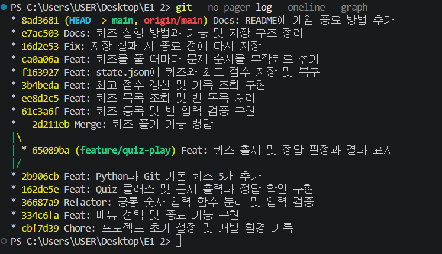

# E1-2 개발 입문 퀴즈 게임

터미널에서 Python과 Git 기초 문제를 풀고 직접 문제를 등록하는 4지선다 게임입니다. 기본 문제는 5개이며, 추가한 문제와 최고 점수는 다음 실행에서도 이어집니다.

## 주제 선정 이유

변수·자료형·조건문·함수·커밋은 이 프로그램을 만들면서 직접 사용한 개념입니다. 구현에 사용한 내용을 문제로 풀며 개발 입문 과정을 복습할 수 있도록 이 주제를 골랐습니다.

## 실행 방법

Python 3.10 이상이 필요합니다. Python 표준 라이브러리만 사용합니다. 처음 내려받는 경우 터미널에서 다음 명령을 실행합니다.

```powershell
git clone https://github.com/codyssey-seungmin/E1-2.git
cd E1-2
python main.py
```

이미 프로젝트 폴더를 열었다면 마지막 줄만 실행합니다. 메뉴가 나타나면 번호를 입력하고 Enter를 누릅니다.

## 기능

| 번호 | 기능 | 동작 |
|---|---|---|
| 1 | 퀴즈 풀기 | 등록된 문제를 모두 풀고, 각 답의 정오와 최종 점수를 확인합니다. |
| 2 | 퀴즈 추가 | 문제, 선택지 4개, 정답 번호(1~4)를 입력하면 저장합니다. |
| 3 | 퀴즈 목록 | 문제 개수와 제목을 등록 순서로 보여줍니다. |
| 4 | 점수 확인 | 최고 점수와 당시의 정답 수·문제 수를 보여줍니다. 첫 플레이 전에는 기록이 없다고 안내합니다. |
| 5 | 종료 | 게임을 끝냅니다. 저장에 실패한 변경이 남아 있으면 한 번 더 저장합니다. |

점수는 정답 수를 전체 문제 수로 나눈 뒤 100을 곱해 정수로 반올림합니다. 첫 기록은 0점도 저장하며, 이후에는 더 높은 점수를 받으면 갱신합니다. **선택 과제인 랜덤 출제**는 1번을 선택할 때마다 문제 목록의 복사본을 섞어 구현했습니다.

빈 입력·문자·범위 밖 번호에는 재입력을 안내합니다. 문제를 입력하는 도중 Ctrl+C 또는 입력 종료(EOF)가 발생하면 완성된 변경 사항을 기준으로 안전하게 종료합니다.

## 파일 구조

| 경로 | 역할 |
|---|---|
| `main.py` | 프로그램 시작점. `Quiz`는 문제 한 개의 출력과 정답 확인을, `QuizGame`은 메뉴·출제·등록·목록·점수·파일 관리를 담당합니다. |
| `state.json` | 첫 실행 때 프로젝트 루트에 자동 생성되는 게임 데이터입니다. |
| `docs/screenshots/` | 개발 환경과 기능별 실행 화면을 담습니다. |
| `.gitignore` | Git에서 제외할 파일을 지정합니다. |
| `README.md` | 실행 방법과 데이터 구조를 안내합니다. |

## 데이터 파일

`main.py`와 같은 폴더의 `state.json`을 UTF-8로 읽고 씁니다. 다음은 문제 한 개를 담은 형식 예시입니다.

```json
{
  "quizzes": [
    {
      "question": "Python에서 정수를 나타내는 자료형은?",
      "choices": ["str", "bool", "int", "list"],
      "answer": 3
    }
  ],
  "best_score": {"score": 100, "correct_count": 1, "total": 1}
}
```

- `quizzes`에는 문제 문장, 선택지 4개, 1부터 세는 정답 번호를 저장합니다.
- `best_score`는 첫 플레이 전에는 `null`입니다. 게임을 마치면 점수(`score`), 맞힌 개수(`correct_count`), 그때 푼 문제 수(`total`)를 함께 기록합니다.
- 파일이 없으면 기본 5문제로 시작합니다. JSON이 손상되었거나 필드 형식이 잘못되면 안내 후 기본 데이터로 초기화합니다. 저장할 때는 임시 파일에 먼저 쓴 뒤 기존 파일을 교체합니다.

## 실행 화면

[개발 환경](docs/screenshots/01_environment.png) · [퀴즈 풀기](docs/screenshots/02_play.png) · [퀴즈 추가](docs/screenshots/03_add_quiz.png) · [퀴즈 목록](docs/screenshots/04_quiz_list.png) · [점수 확인](docs/screenshots/05_score.png)

게임을 종료하려면 메뉴에서 5번을 선택하세요.

## Git 작업 이력

커밋 `8a0d5ed` 기준으로 총 17개입니다. 다음은 `git log --graph --oneline 8a0d5ed` 출력입니다.

```text
* 8a0d5ed Docs: 점수 조회 화면을 실제 실행 캡처로 교체
* 0ebbc3c Docs: Git 커밋 및 브랜치 병합 그래프 캡처 추가
* 8ad3681 Docs: README에 게임 종료 방법 추가
* e7ac503 Docs: 퀴즈 실행 방법과 기능 및 저장 구조 정리
* 16d2e53 Fix: 저장 실패 시 종료 전에 다시 저장
* ca0a06a Feat: 퀴즈를 풀 때마다 문제 순서를 무작위로 섞기
* f163927 Feat: state.json에 퀴즈와 최고 점수 저장 및 복구
* 3b4beda Feat: 최고 점수 갱신 및 기록 조회 구현
* ee8d2c5 Feat: 퀴즈 목록 조회 및 빈 목록 처리
* 61c3a6f Feat: 퀴즈 등록 및 빈 입력 검증 구현
*   2d211eb Merge: 퀴즈 풀기 기능 병합
|\
| * 65089ba Feat: 퀴즈 출제 및 정답 판정과 결과 표시
|/
* 2b906cb Feat: Python과 Git 기본 퀴즈 5개 추가
* 162de5e Feat: Quiz 클래스 및 문제 출력과 정답 확인 구현
* 36687a9 Refactor: 공통 숫자 입력 함수 분리 및 입력 검증
* 334c6fa Feat: 메뉴 선택 및 종료 기능 구현
* cbf7d39 Chore: 프로젝트 초기 설정 및 개발 환경 기록
```

`feature/quiz-play`에서 출제와 채점을 구현한 커밋은 `65089ba`입니다. `main`으로 돌아와 `git merge --no-ff feature/quiz-play`로 병합한 기록이 `2d211eb`입니다.



### clone과 pull 실습 기록

원래 작업 폴더 옆에 `E1-2-clone`을 복제한 뒤, 복제본 README에 게임 종료 안내를 추가하고 커밋·푸시했습니다. 원래 폴더에서 그 커밋을 받아왔습니다. 아래 첫 줄은 복제본의 Git HEAD 로그에서 추출한 이벤트이고, 둘째 줄은 원래 폴더의 `git reflog --format="%h %gs"` 출력입니다.

```text
clone: from https://github.com/codyssey-seungmin/E1-2.git
8ad3681 pull --ff-only origin main: Fast-forward
```

원래 폴더에서 `git show 8ad3681 -- README.md`를 실행하면 복제본에서 추가한 “게임을 종료하려면 메뉴에서 5번을 선택하세요.” 문장을 확인할 수 있습니다.

### 커밋 단위와 메시지

기능 추가, 오류 수정, 구조 정리, 문서 변경을 각각 검토할 수 있는 단위로 커밋합니다. 메시지 형식은 `유형: 변경 내용`입니다. 예를 들어 `Feat: 최고 점수 갱신 및 기록 조회 구현`은 기능 추가, `Fix: 저장 실패 시 종료 전에 다시 저장`은 오류 수정입니다. 역할 분리는 `Refactor`, 설명이나 실행 캡처 변경은 `Docs`를 사용합니다.

## 클래스 재사용과 JSON 선택 이유

직접 등록한 문제는 `Quiz(question, choices, answer)`로, JSON에서 읽은 문제는 `Quiz(**item)`으로 만듭니다. 두 경우 모두 같은 `Quiz` 객체이므로 게임은 같은 `display()`로 문제를 출력하고 `check_answer()`로 정답을 검사합니다.

JSON은 문제 목록과 그 안의 선택지 네 개를 배열로, 문제 문장과 정답 번호를 키와 값으로 표현할 수 있습니다. UTF-8과 들여쓰기를 사용해 사람이 파일을 열어 한글 문제와 점수를 읽기 쉽습니다. 표준 형식이어서 다른 프로그램에서도 같은 구조를 읽을 수 있고, Python에서는 표준 라이브러리만으로 처리할 수 있습니다.

## 퀴즈 1,000개 저장·불러오기 실측

Windows의 Python 3.13.15에서 한국어 문제 1,000개(문제마다 선택지 4개)를 임시 폴더에 생성했습니다. 실제 `QuizGame.save_state()`와 새 `QuizGame()`의 불러오기를 각각 5회 실행하고, 매번 복원된 문제가 1,000개인지 확인했습니다.

| 측정 항목 | 결과 |
|---|---:|
| UTF-8 JSON 파일 크기 | 172,937바이트 |
| 전체 저장 시간 중앙값 | 12.94ms |
| 게임 생성 및 전체 불러오기 시간 중앙값 | 14.38ms |
| 별도 1회 불러오기 중 Python 메모리 할당 최고치(tracemalloc) | 896,269바이트 |

이 수치는 해당 PC와 예제 문장 길이에서 측정한 값입니다. 현재는 한 문제를 추가해도 전체 파일을 다시 쓰고, 시작할 때 전체 목록을 메모리로 읽습니다. 목록 출력도 모든 항목을 순회하므로 문제 수가 늘면 출력이 길어집니다. 개선한다면 먼저 한 화면에 20개씩 표시하고, 개별 문제 조회·수정이 잦아지면 SQLite에 문제 ID를 두어 해당 행만 읽고 쓰도록 할 수 있습니다.

## 이전 버전 백업과 복원 절차 (설계)

현재 구현은 `state.json.tmp`에 쓰기를 마친 뒤 `state.json`을 교체합니다. 파일이 이미 손상된 상태로 시작하면 기본 문제로 초기화하므로, **이전 정상 버전을 보관하는 기능은 개선 설계**로 아래에 기록합니다.

1. 새 데이터를 임시 파일에 완전히 기록합니다. 기존 `state.json`을 읽어 문제와 최고 점수가 유효한 경우에만 이를 별도 임시 백업에 복사한 뒤 `state.json.bak`으로 교체합니다. 최근 정상본 한 버전을 보관합니다.
2. 정상본 백업에 실패하면 기존 파일을 유지하고 실패를 안내합니다. 백업이 준비됐거나 첫 저장이면 새 임시 파일로 본 파일을 교체합니다.
3. 시작할 때 본 파일이 없거나 손상된 경우 백업을 검증합니다. 백업이 정상이면 그 내용으로 본 파일을 복원하고, 사용 가능한 파일이 모두 없으면 기본 문제로 시작합니다. 복원할 때는 손상된 본 파일이 정상 백업을 덮어쓰지 않도록 합니다.

## 메뉴 선택과 재실행 검증 (실제 터미널 출력 발췌)

빈 임시 폴더에 같은 main.py를 복사해 실행했습니다. 입력도 출력에 표시했습니다. 첫 실행에서 2번으로 문제를 하나 등록하고 1번으로 여섯 문제를 풀었습니다. 아래는 메뉴 선택, 채점, 종료에 해당하는 줄입니다.

```text
1. 퀴즈 풀기
선택: 2
퀴즈가 추가되었습니다! (총 6개)
1. 퀴즈 풀기
선택: 1
퀴즈를 시작합니다! (총 6문제)
[문제 1]
정답 입력 (1~4): 1
오답입니다. 정답은 2번입니다.
[문제 2]
정답 입력 (1~4): 1
오답입니다. 정답은 2번입니다.
[문제 3]
정답 입력 (1~4): 1
오답입니다. 정답은 4번입니다.
[문제 4]
정답 입력 (1~4): 1
오답입니다. 정답은 3번입니다.
[문제 5]
정답 입력 (1~4): 1
정답입니다!
[문제 6]
정답 입력 (1~4): 1
정답입니다!
결과: 6문제 중 2문제 정답! (33점)
새로운 최고 점수입니다!
1. 퀴즈 풀기
선택: 5
퀴즈 게임을 종료합니다.
```

첫 프로세스가 종료된 뒤 같은 폴더에서 새 Python 프로세스로 다시 실행했습니다. 3번에서 추가한 여섯 번째 문제를, 4번에서 이전 실행의 최고 점수를 조회했습니다.

```text
저장된 데이터를 불러왔습니다. (퀴즈 6개)
선택: 3
등록된 퀴즈 목록 (총 6개)
[6] 화면 출력 함수는?
선택: 4
최고 점수: 33점 (6문제 중 2문제 정답)
선택: 5
퀴즈 게임을 종료합니다.
```
